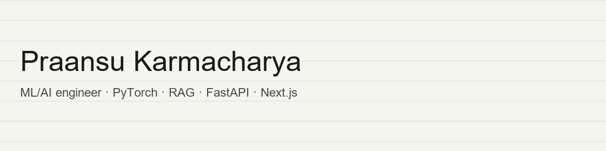

  <h2 style="margin: 0 0 10px 0; font-size: 1.6em; font-weight: 800; color: #1a1a2e; letter-spacing: -0.01em;">About Me</h2>
  
I'm Praansu. CS student at Islington College, Kathmandu (Class of 2028) and Junior AI Developer Intern at Aviyaan Tech.

  
I build ML models and the products around them — PyTorch, RAG pipelines, agent tool-calling, FastAPI, Next.js. Things break, I fix them, I ship what works.

  
Interning at Aviyaan Tech on ensemble methods for traffic-count estimation and road-damage segmentation. Before that I taught myself deep learning from scratch and kept building until something worked.

  

    <h3 style="margin: 0 0 14px 0; font-size: 1em; font-weight: 800; color: #24292e; text-transform: uppercase; letter-spacing: 0.06em;">Profile</h3>
    
<strong style="color: #1a1a2e;">15</strong> public repositories

    
<strong style="color: #1a1a2e;">1</strong> star — ParkX smart parking

    
<strong style="color: #1a1a2e;">0</strong> followers · <strong style="color: #1a1a2e;">4</strong> following

    
<strong style="color: #1a1a2e;">Joined</strong> June 2025

  

  

    <h3 style="margin: 0 0 14px 0; font-size: 1em; font-weight: 800; color: #24292e; text-transform: uppercase; letter-spacing: 0.06em;">Languages</h3>
    
Primary: Python · TypeScript

    
Secondary: HTML · ESP32

    
Frameworks: FastAPI · Next.js · PyTorch

    
Tools: ChromaDB · Docker · Prisma · SQLite

  

<h2 style="font-size: 1.7em; font-weight: 800; margin: 0 0 18px 0; color: #1a1a2e; border-left: 5px solid #24292e; padding-left: 18px;">Contact</h2>

  
  
  

<h2 style="font-size: 1.7em; font-weight: 800; margin: 0 0 18px 0; color: #1a1a2e; border-left: 5px solid #24292e; padding-left: 18px;">Experience</h2>

<table style="width: 100%; border-collapse: separate; border-spacing: 0 16px; margin-bottom: 44px;">
  <tr style="vertical-align: top;">
    <td style="width: 200px; font-weight: 800; color: #1a1a2e; font-size: 0.95em;">Junior AI Developer (Intern)</td>
    <td style="font-size: 0.98em;">
      <strong style="color: #24292e;">Aviyaan Tech</strong> · Mar 2026 — Present 
      Ensemble methods for traffic-count estimation and road-damage segmentation.
    </td>
  </tr>
  <tr style="vertical-align: top;">
    <td style="width: 200px; font-weight: 800; color: #1a1a2e; font-size: 0.95em;">Independent Builder</td>
    <td style="font-size: 0.98em;">
      <strong style="color: #24292e;">Personal Projects</strong> · 2024 — Present 
      RAG loops, agent harnesses, vision models, full-stack demo storefront. Open to freelance RAG + agent work.
    </td>
  </tr>
  <tr style="vertical-align: top;">
    <td style="width: 200px; font-weight: 800; color: #1a1a2e; font-size: 0.95em;">BSc (Hons) Computing with AI</td>
    <td style="font-size: 0.98em;">
      <strong style="color: #24292e;">Islington College, Kathmandu</strong> · 2025 — 2028 
      Coursework and self-directed builds in PyTorch, RAG pipelines, agent tool-calling, full-stack deployment.
    </td>
  </tr>
</table>

<h2 style="font-size: 1.7em; font-weight: 800; margin: 0 0 18px 0; color: #1a1a2e; border-left: 5px solid #24292e; padding-left: 18px;">Selected Work</h2>

  

    <h4 style="margin: 0 0 6px 0; font-size: 1.05em; font-weight: 700; color: #1a1a2e;"><a href="https://github.com/Praansu/ai-research-agent" style="text-decoration: none; color: #0969da;">AI Research Agent</a></h4>
    github.com/Praansu/ai-research-agent
    
Custom agent loop, no LangChain. Routes between local docs (ChromaDB) and web search, streams every tool call live. Fixed a two-day bug where it kept calling the wrong tool — system prompt was too vague.

    
Python · FastAPI · ChromaDB · SSE

  

  

    <h4 style="margin: 0 0 6px 0; font-size: 1.05em; font-weight: 700; color: #1a1a2e;"><a href="https://github.com/Praansu/pdf-chat-rag" style="text-decoration: none; color: #0969da;">PDF Chat RAG</a></h4>
    github.com/Praansu/pdf-chat-rag
    
Upload a PDF, ask questions. Added delete-docs and streaming after re-uploading the same file ten times. Answers stream token by token.

    
Python · FastAPI · ChromaDB · PyMuPDF

  

  

    <h4 style="margin: 0 0 6px 0; font-size: 1.05em; font-weight: 700; color: #1a1a2e;"><a href="https://github.com/Praansu/vehicle-image-classifier" style="text-decoration: none; color: #0969da;">Vehicle Image Classifier</a></h4>
    github.com/Praansu/vehicle-image-classifier
    
PyTorch ResNet-18, sorts bus/car/bike/truck. 90% on my own 400-image set — labelled every image myself with a PyQt tool I made. Served behind FastAPI, containerised.

    
PyTorch · ResNet-18 · FastAPI · Docker

  

  

    <h4 style="margin: 0 0 6px 0; font-size: 1.05em; font-weight: 700; color: #1a1a2e;"><a href="https://github.com/Praansu/eco-verda" style="text-decoration: none; color: #0969da;">Eco-Verda</a></h4>
    github.com/Praansu/eco-verda
    
Eco products store to learn Next.js properly. Blur-up images, debounced search that syncs to the URL. Broke checkout twice before webhooks finally worked. Stripe not wired yet — known issue.

    
Next.js · TypeScript · Prisma · Stripe

  

  

    <h4 style="margin: 0 0 6px 0; font-size: 1.05em; font-weight: 700; color: #1a1a2e;"><a href="https://github.com/Praansu/ParkX" style="text-decoration: none; color: #0969da;">ParkX</a></h4>
    github.com/Praansu/ParkX
    
Smart parking across ESP32 + FastAPI + dashboard. Local Ollama chatbot with Groq fallback, guardrailed to parking questions only.

    
ESP32 · FastAPI · Ollama

  

  

    <h4 style="margin: 0 0 6px 0; font-size: 1.05em; font-weight: 700; color: #1a1a2e;"><a href="https://github.com/Praansu/health-guard-ml" style="text-decoration: none; color: #0969da;">Health Guard ML</a></h4>
    github.com/Praansu/health-guard-ml
    
Heart disease prediction, XGBoost + SHAP so it explains itself. Still a stub with honest TODOs.

    
XGBoost · SHAP

  

<h2 style="font-size: 1.7em; font-weight: 800; margin: 0 0 14px 0; color: #1a1a2e; border-left: 5px solid #24292e; padding-left: 18px;">Smaller Stuff</h2>

<ul style="list-style: none; padding: 0; margin-bottom: 44px;">
  <li style="margin-bottom: 12px; font-size: 0.95em;"><strong style="color: #1a1a2e;">nnunet-road-cracks</strong> — Crack-segmentation packaging over nnunet.</li>
  <li style="margin-bottom: 12px; font-size: 0.95em;"><strong style="color: #1a1a2e;">demand-predictor-ml</strong> — Parking demand forecasting with XGBoost and scikit-learn.</li>
  <li style="margin-bottom: 12px; font-size: 0.95em;"><strong style="color: #1a1a2e;">small-agent-reliability</strong> — Testing if 3B-9B models can work as agents. 14 tasks. They kept breaking in weird ways.</li>
  <li style="margin-bottom: 12px; font-size: 0.95em;"><strong style="color: #1a1a2e;">vehicle-labeling-tool</strong> — Tiny PyQt app I made to label training data faster. (archived)</li>
</ul>

<h2 style="font-size: 1.7em; font-weight: 800; margin: 0 0 14px 0; color: #1a1a2e; border-left: 5px solid #24292e; padding-left: 18px;">Stack</h2>

  Python
  TypeScript
  PyTorch
  FastAPI
  Next.js
  ChromaDB
  Docker

Have used:

scikit-learn, XGBoost, OpenCV, Prisma, Streamlit, Flask, SQLite, ESP32, Java, C++

If it's listed, I've shipped something with it.

  <a href="mailto:Praansu12@gmail.com" style="text-decoration: none; color: #1a1a2e; margin: 0 16px; font-weight: 600;">Email</a>
  <a href="https://praansu.github.io" style="text-decoration: none; color: #1a1a2e; margin: 0 16px; font-weight: 600;">Portfolio</a>
  <a href="https://np.linkedin.com/in/praansu-karmacharya-694944368" style="text-decoration: none; color: #1a1a2e; margin: 0 16px; font-weight: 600;">LinkedIn</a>

